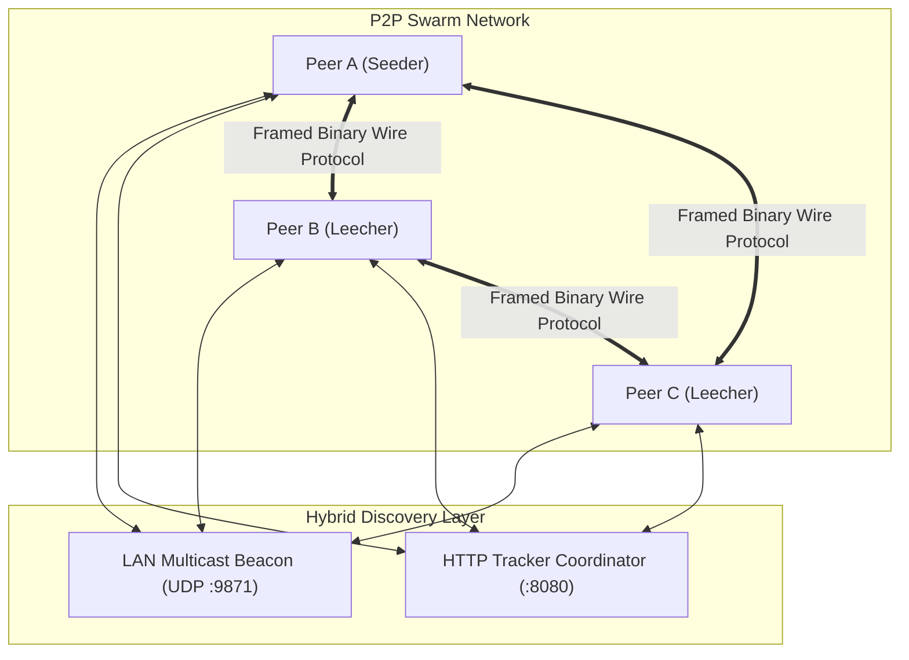

# P2P File Distribution Engine

[](https://github.com/saivenkatramineni/p2p/actions/workflows/ci.yml)
[](https://goreportcard.com/report/p2p)
[](LICENSE)

A high-performance, production-grade peer-to-peer (P2P) file distribution engine in Go, inspired by the architecture of **CNCF Dragonfly**, **Uber Kraken**, and the **BitTorrent protocol**.

Designed for high-throughput, fault-tolerant distribution of large files (container images, ML models, VM snapshots, software builds) across distributed server fleets or local networks.

---

## Key Features

* **Cryptographic Block Verification**: Files are split into fixed-size chunks (default: 256 KB) with SHA-256 verification per block. Poisoned or corrupted chunks are rejected and re-requested.
* **Hybrid Discovery**:
  * **LAN Zero-Config**: UDP multicast/broadcast (`239.255.42.99:9871`) pairs nodes in the same subnet/VPC in under 100 milliseconds without central servers.
  * **Lightweight Tracker**: Embedded HTTP coordinator (`/announce`) for multi-cluster and WAN discovery.
* **Smart Swarm Scheduling**:
  * **Rarest-First Scheduling**: Prioritizes chunks with lowest availability in the swarm to prevent chunk extinction.
  * **Pipelined Transfers**: Multiple 16 KB sub-blocks in flight per peer to saturate network bandwidth.
* **Out-of-Order Disk Assembly & Seamless Resume**:
  * Sparse file pre-allocation (`os.Truncate`) and concurrent random-access writes (`file.WriteAt`).
  * Bitfield state verified on disk on startup so interrupted downloads resume immediately without restarting.
* **Production CI/CD**:
  * GitHub Actions matrix testing on Go `1.22+` across Linux and macOS.
  * Race detector (`-race`), `go vet`, formatting checks, and cross-platform compilation (Linux, macOS, Windows).

---

## Architecture Overview



---

## Wire Protocol Framing

All communications over peer TCP streams use 4-byte big-endian length prefixing:
```text
+-----------------------+---------------+--------------------+
| 4-byte length prefix  | 1-byte Msg ID | Payload (N bytes)  |
+-----------------------+---------------+--------------------+
```

| ID | Message Name | Description |
| :---: | :--- | :--- |
| `0x00` | `MsgChoke` | Chokes the remote peer from requesting pieces |
| `0x01` | `MsgUnchoke` | Unchokes the remote peer |
| `0x02` | `MsgInterested` | Signals interest in remote peer's pieces |
| `0x03` | `MsgNotInterested` | Signals lack of interest |
| `0x04` | `MsgHave` | Announces piece index completion |
| `0x05` | `MsgBitfield` | Synchronizes complete chunk availability bitmask |
| `0x06` | `MsgRequest` | Requests `index`, `begin`, and `length` of chunk |
| `0x07` | `MsgPiece` | Delivers chunk block data |
| `0x08` | `MsgCancel` | Cancels a pending chunk request |

---

## Installation & Build

### Prerequisites
* Go 1.22+ installed.

### Build
```bash
# Clone the repository
git clone https://github.com/saivenkatramineni/p2p.git
cd p2p

# Compile standalone binary
make build

# Output binary located at ./bin/p2p
./bin/p2p version
```

---

## Quickstart Guide

### 1. (Optional) Start Central Tracker
If connecting nodes across different networks:
```bash
./bin/p2p tracker --port 8080
```

### 2. Share / Seed a File
Create a `.p2p` manifest and begin seeding:
```bash
# Auto-discovers peers on LAN via UDP multicast
./bin/p2p share /path/to/large-file.tar.gz

# Or specify a tracker for WAN / multi-subnet sharing:
./bin/p2p share /path/to/large-file.tar.gz --tracker http://tracker-ip:8080/announce
```
This generates `/path/to/large-file.tar.gz.p2p`.

### 3. Inspect Manifest
```bash
./bin/p2p info large-file.tar.gz.p2p
```

### 4. Download from the Swarm
Distribute the `.p2p` manifest to client machines and execute:
```bash
./bin/p2p download large-file.tar.gz.p2p --dir ./downloads --workers 4
```
A live progress bar displays completion percentage, active peers, and download rate. Once complete, the downloader automatically transitions into a seeder to assist other swarm members.

### 5. Verify Integrity
Verify existing downloaded files against the cryptographic manifest:
```bash
./bin/p2p verify large-file.tar.gz.p2p ./downloads/large-file.tar.gz
```

---

## Development & Testing

```bash
# Run unit & race detection tests
make test-race

# Run linter & code format check
make lint

# Format code
make format

# Clean build artifacts
make clean
```

---

## CI/CD Workflow

The GitHub Actions workflow at [`.github/workflows/ci.yml`](.github/workflows/ci.yml) triggers on every push and pull request:
1. **Linting**: Enforces strict `gofmt` code style and `go vet`.
2. **Race-Condition Testing**: Executes the full test suite with Go's `-race` detector across Linux and macOS.
3. **Cross-Compilation**: Automatically builds release binaries for:
   * Linux (`amd64`, `arm64`)
   * macOS (`darwin-amd64`, `darwin-arm64`)
   * Windows (`windows-amd64.exe`)
   Generates `checksums.txt` and publishes artifacts.
